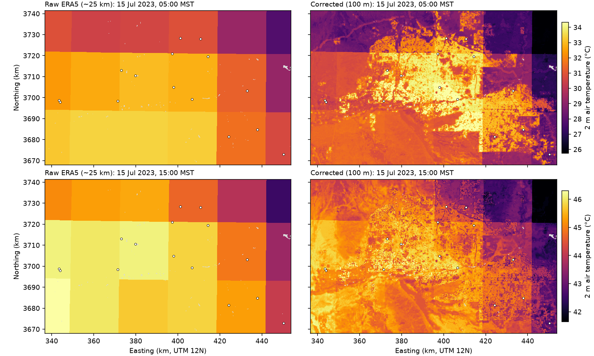

# street-air-temperature


Estimating street-level 2 m **air** temperature in Phoenix from coarse ERA5 reanalysis (~25 km), land cover, vegetation and elevation, validated on weather stations the model never saw.

**Status:** milestones 1-5 done: 15 stations, a correction that cuts ERA5's error at unseen stations by 20%, a STAC catalog of 100 m maps with an area of applicability, a FastAPI service in Docker, and an LLM experiment agent whose tuning was confirmed on the full evaluation.

Companion to [Urban-Heat-Downscaling](https://github.com/SaraEwaida/Urban-Heat-Downscaling), which downscales satellite **land surface** temperature. Surface temperature is the skin of roofs, roads and sand; air temperature at 2 m is what people feel. This project targets the second.

## Why

Reanalysis such as ERA5 gives hourly air temperature everywhere, but one value per ~25 km cell: it cannot separate a downtown street from an irrigated park or open desert a few kilometres away. Weather stations measure the real local value, but only at a few points. The goal is to learn the local correction from what surrounds each station, so it can be applied anywhere in the city.

## Data

All sources are free and need no account.

| Data | Source | Resolution | Use |
|---|---|---|---|
| Station air temperature | NOAA Integrated Surface Database (global-hourly CSV), via NOAA Open Data Dissemination on AWS | point, hourly | target (airports) |
| Station air temperature | Arizona Meteorological Network (AZMet) API, University of Arizona | point, hourly | target (turf, farmland, suburbs) |
| ERA5 2 m air temperature | Open-Meteo historical archive, `models=era5` | 0.25° (~25 km), hourly | coarse input |
| Land cover | ESA WorldCover v200, Planetary Computer | 10 m | site features |
| Elevation | Copernicus DEM GLO-30, Planetary Computer | 30 m | site features, lapse-rate baseline |
| Vegetation | Landsat 8/9 Collection 2 Level-2 NDVI, Planetary Computer | 30 m | site features |

Details that matter:

- **Station files** come from the `noaa-global-hourly-pds` S3 bucket: NCEI ended direct HTTPS download of ISD CSV in 2026, and ISD is superseded by GHCNh with no updates after August 2025. The 2023 study year is fully covered; GHCNh is the source to switch to for recent years.
- **ERA5 is requested as the raw grid-cell value** (`elevation=nan`). By default Open-Meteo adjusts temperature to the point's elevation; that correction is computed separately here as an explicit baseline (standard lapse rate, -6.5 °C/km), so the model's gain over it is visible.
- **Two station networks.** All NOAA stations around Phoenix are airports: open, paved and similar to each other, so on their own they cannot show what makes a park or farmland different. AZMet adds Phoenix Encanto and Phoenix Greenway (irrigated turf), Desert Ridge, Queen Creek and Buckeye (farmland and suburban edge). AZMet values are hourly averages stamped at the end of the hour, so they are assigned to the hour they end, matching ISD's routine reports a few minutes before the hour and ERA5 on the hour.
- **Station quality control:** ISD quality codes 2, 3, 6 and 7 are dropped; routine hourly METAR reports (FM-15) are preferred when several reports fall in one hour; values outside -15 to 55 °C are removed; single-hour spikes of more than 8 °C against both neighbouring hours are removed; stations with less than 55% of hours left are dropped. The threshold is 55%, not higher, because Chandler, Glendale and Goodyear airports report only about 60% of hours; errors will be reported by hour of day, so partial coverage does not bias the comparison. A per-station report is written to `outputs/qc_report.csv`.
- **Site features** are computed in circles of 100 m and 500 m around each station on a local UTM 12N grid: land-cover fractions (built-up, tree, shrub, grass/crop, bare, water), mean elevation, and median summer NDVI over up to five clear Landsat scenes. Station coordinates are deliberately not features, so the model has to learn from surroundings, not memorise places.
- Phoenix stays on MST (UTC-7) all year, so local hour is unambiguous.

## Setup

```bash
git clone https://github.com/SaraEwaida/street-air-temperature.git
cd street-air-temperature
python -m venv .venv && source .venv/bin/activate      # Windows: .venv\Scripts\Activate.ps1
pip install -e ".[dev,api]"
pytest
```

## Reproduce milestone 1

```bash
sat stations configs/phoenix.yaml   # NOAA stations, download, QC -> data/phoenix/observations.parquet
sat era5 configs/phoenix.yaml       # ERA5 at each station        -> data/phoenix/era5.parquet
sat features configs/phoenix.yaml   # site features                -> data/phoenix/site_features.csv
sat build configs/phoenix.yaml      # station-hour table           -> data/phoenix/dataset.parquet
sat map configs/phoenix.yaml        # station map                  -> outputs/figures/phoenix_stations.png
```

Or all steps at once: `sat all configs/phoenix.yaml`.

## Results

### Milestone 1: ERA5 against 15 stations, 2023

All 15 stations passed quality control (10 NOAA airports, 5 AZMet sites), giving 120,617 station-hours. Bias is ERA5 minus station in °C, so **negative = station warmer than ERA5**. Night is 19:00-06:00 local time.


| Station | Network | Bias, all hours | Night | Day | Built-up within 500 m | NDVI within 500 m |
|---|---|---:|---:|---:|---:|---:|
| Phoenix Sky Harbor (KPHX) | NOAA | -1.22 | **-1.72** | -0.73 | 0.61 | 0.05 |
| Falcon Field (KFFZ) | NOAA | -0.63 | -1.07 | -0.19 | 0.62 | 0.18 |
| Deer Valley (KDVT) | NOAA | -0.39 | -0.41 | -0.36 | 0.39 | 0.13 |
| Chandler (KCHD) | NOAA | +0.24 | -0.38 | +0.44 | 0.53 | 0.11 |
| Goodyear (KGYR) | NOAA | -0.01 | -0.08 | +0.01 | 0.41 | 0.14 |
| Scottsdale (KSDL) | NOAA | +0.24 | -0.05 | +0.53 | 0.73 | 0.14 |
| Glendale (KGEU) | NOAA | +0.23 | +0.12 | +0.26 | 0.50 | 0.10 |
| Luke AFB (KLUF) | NOAA | +0.24 | +0.28 | +0.20 | 0.17 | 0.13 |
| Williams Gateway (KIWA) | NOAA | +0.95 | +0.84 | +1.06 | 0.43 | 0.09 |
| Buckeye airport (KBXK) | NOAA | +1.24 | +1.99 | +0.50 | 0.21 | 0.13 |
| Desert Ridge (DES) | AZMet | +0.56 | +0.80 | +0.33 | 0.40 | 0.37 |
| Phoenix Greenway (PGR) | AZMet | +0.92 | +0.89 | +0.95 | 0.58 | 0.26 |
| Phoenix Encanto (PEN) | AZMet | +1.03 | +1.23 | +0.84 | 0.41 | 0.42 |
| Buckeye (BUC) | AZMet | +1.36 | +2.05 | +0.67 | 0.08 | 0.55 |
| Queen Creek (QCR) | AZMet | +1.63 | **+2.23** | +1.03 | 0.04 | 0.56 |

Overall: bias +0.45 °C, MAE 1.27 °C.

- **ERA5's night-time error follows the surroundings.** Across the 15 stations it correlates at -0.74 with built-up fraction and +0.71 with NDVI: ERA5 is too cool over dense, paved sites (the urban heat island, strongest at Sky Harbor) and too warm over irrigated parks and farmland (evaporative cooling, strongest at Queen Creek and Buckeye).
- **The effect is largest at night**, when the urban heat island is strongest, which is why errors will be reported by hour of day.
- **Without AZMet this was invisible:** airports alone span too narrow a range of surroundings. With 15 stations these correlations are a strong hint, not a result; testing on held-out stations in milestone 2 decides how much of it a model can use.
- Desert Ridge lost 42 hours to the range check, probably a sensor fault; every other station lost fewer than 3 hours to quality control.

## Reproduce milestone 2

ERA5 now also includes wind, cloud cover, sunshine and humidity, so re-run the ERA5 and build steps once:

```bash
sat era5 configs/phoenix.yaml
sat build configs/phoenix.yaml
sat model configs/phoenix.yaml      # leave-one-station-out evaluation + final model
```

### Model setup

- **Target:** station temperature minus raw ERA5. Every method predicts the station temperature, so all are scored on the same scale.
- **Validation: leave one station out.** Each of the 15 stations is held out in turn; models, imputers and scalers are fitted on the other 14 only. This answers the real question: how well does the correction work at a place with no station?
- **Methods:**
  - raw ERA5;
  - ERA5 moved to the station's elevation with a standard lapse rate;
  - ERA5 plus the training stations' mean offset;
  - Ridge regression on the features, with site x night interactions;
  - LightGBM on the same features.
- **Features:** land-cover fractions and NDVI within 100 m and 500 m, height relative to the ERA5 cell, hour of day and day of year (as sine and cosine), and ERA5 weather at that hour (temperature, 3-hour change, daily mean, wind, cloud cover, solar radiation, humidity). No station coordinates or names, so a held-out station is predicted only from its surroundings and the weather.
- **Setting:** reconstruction of past hours. The ERA5 daily mean uses the whole day, which is fine for historical maps but not for real-time use.
- **Outputs:** `outputs/model_summary.csv` (overall, night and day, and per network), `model_by_station.csv`, `model_by_hour.csv`, `model_importance.csv`, and figures `error_by_hour.png`, `error_by_station.png`.

### Milestone 2 results

Every number is from stations the model never saw (leave one station out, 15 folds, 120,617 station-hours). Errors are prediction minus station, °C.

| Method | MAE | RMSE | Bias | Night MAE | Day MAE | Mean absolute station offset |
|---|---:|---:|---:|---:|---:|---:|
| Raw ERA5 | 1.27 | 1.75 | +0.45 | 1.63 | 0.96 | 0.73 |
| ERA5 + lapse rate | 1.41 | 1.90 | +0.84 | 1.76 | 1.10 | 0.96 |
| ERA5 + constant offset | 1.26 | 1.72 | 0.00 | 1.62 | 0.94 | 0.68 |
| Ridge | 1.14 | 1.51 | -0.01 | **1.26** | 1.04 | **0.26** |
| **LightGBM** | **1.02** | **1.37** | -0.05 | 1.27 | **0.80** | 0.50 |

"Mean absolute station offset" is the average, over held-out stations, of the size of each station's mean error: how well a method gets a place's typical warmth or coolness right.

| Network | Raw ERA5 MAE | Ridge MAE | LightGBM MAE |
|---|---:|---:|---:|
| NOAA airports (76,899 h) | 1.12 | 1.05 | **1.02** |
| AZMet turf and farmland (43,718 h) | 1.54 | 1.31 | **1.01** |


- **LightGBM cuts the error at unseen stations by 20%** (1.27 to 1.02 °C) and removes the overall warm bias of ERA5. These are the tuned settings found by the experiment agent (`num_leaves=31`, `min_child_samples=100`); with the original settings the figures were 1.03 °C and 19%.
- **The gain is largest where ERA5 is worst:** irrigated and agricultural AZMet sites go from 1.54 to 1.01 °C, for example Phoenix Greenway 1.21 to 0.70 and Buckeye 1.69 to 0.98.
- **Ridge and LightGBM are good at different things.** At night they are level (1.26 vs 1.27 °C), and Ridge gets each station's typical offset far closer (0.26 vs 0.50 °C): with few stations, a smooth linear site effect generalises better than tree splits. LightGBM is clearly best by day, where the correction depends on weather and time; Ridge is in fact worse than raw ERA5 between about 10:00 and 17:00, because a fixed linear site effect suits the night but over-corrects in the afternoon. Combining the two is the obvious next step.
- **A standard lapse-rate correction makes ERA5 worse.** At night cold air collects in the low parts of the basin, so lower is not warmer; a fixed -6.5 °C/km adjustment fails here.
- **Most important LightGBM features:** built-up fraction within 100 m (18% of gain), ERA5 humidity (8%), hour of day (6% each for its sine and cosine), wind speed (6%), and ERA5's 3-hour temperature change (6%).
- **Not uniform across stations.** LightGBM is worse than raw ERA5 at three west-side airports (Luke, Glendale, Goodyear) and Ridge at Deer Valley and Desert Ridge. With 15 stations, per-station results are noisy, and more stations (or more years) are the main way to firm them up.

## Reproduce milestone 3: temperature catalog

```bash
sat grid configs/phoenix.yaml       # site features for every 100 m pixel -> data/phoenix/grid_features.npz
sat catalog configs/phoenix.yaml    # maps for 8 hours, COGs + STAC     -> data/phoenix/catalog/
```

- **Grid features** are the station features computed for every 100 m pixel: WorldCover read at 10 m, class fractions and Landsat NDVI averaged over discs of 100 m and 500 m on a 50 m base grid, and DEM height. `sat grid` compares them with the stations' own 10 m-circle features at the 15 station pixels (`outputs/grid_feature_check.csv`), so the approximation is measured, not assumed.
- **Weather** for each pixel is ERA5 interpolated bilinearly between the 0.25° cell centres (temperature, 3-hour change, daily mean, wind, cloud, radiation, humidity, cell height). A first version used each pixel's whole cell and the maps showed the ERA5 grid as straight 1-3 °C steps with no physical meaning; interpolation removes them. Stations were compared with raw cell values, so this is a small mismatch between training and mapping, accepted because most stations lie well inside their cell.
- **Maps:** the final LightGBM from milestone 2 (trained on all 15 stations) predicts the correction for every land pixel; water pixels (more than 50% water within 100 m) are nodata.
- **Hours mapped:** the 15th of January, April, July and October 2023, at 05:00 (near the daily minimum, strongest urban heat island) and 15:00 (near the maximum), MST.
- **Catalog:** a self-contained STAC Collection with one Item per hour, using the projection and raster extensions. Each Item has three Cloud-Optimised GeoTIFF assets: `temperature`, `era5` (raw, same grid) and `correction`. The folder can be moved or uploaded as is: all links are relative.
- **Where the maps can be trusted.** The collection assets `area_of_applicability` and `dissimilarity_index` follow Meyer & Pebesma (2021), *Predicting into unknown space? Estimating the area of applicability of spatial prediction models*, Methods in Ecology and Evolution 12(9). Each pixel's site features are standardised, weighted by LightGBM importance, and compared with the nearest training station; the threshold is set by how unusual the stations were relative to each other, mirroring leave-one-station-out validation. A first, per-feature range check flagged 80% of land as extrapolation even in ordinary neighbourhoods, because a box over 15 features is far stricter than what the model's accuracy depends on; it is kept as a diagnostic (`outputs/catalog_support.csv`).
- Summary per hour: `outputs/catalog_summary.csv`; figure: `outputs/figures/air_temperature_july.png`.

### Milestone 3 results



**Grid features match the station features.** At the 15 station pixels, the 500 m disc features differ from the stations' own 10 m-circle values by at most 0.02 (fractions, NDVI); the 100 m features by up to 0.09 (built-up) because a 100 m disc spans only a few cells of the 50 m base grid (`outputs/grid_feature_check.csv`).

**Corrections by hour** (858,195 land pixels per map, tuned LightGBM, `outputs/catalog_summary.csv`):

| Local time (MST) | ERA5 mean | Corrected mean | Correction, 5th-95th percentile | Spread across the city (95th-5th) |
|---|---:|---:|---|---:|
| 15 Jan 05:00 | 10.9 | 10.6 | -1.4 to +1.5 | 4.0 |
| 15 Jan 15:00 | 14.7 | 14.5 | -0.6 to +0.2 | 6.2 |
| 15 Apr 05:00 | 12.4 | 11.3 | -3.5 to +2.7 | 7.6 |
| 15 Apr 15:00 | 28.2 | 27.9 | -0.6 to +0.2 | 2.4 |
| 15 Jul 05:00 | 31.8 | 30.6 | -2.6 to +1.8 | 6.7 |
| 15 Jul 15:00 | 45.3 | 44.4 | -1.6 to +0.1 | 3.3 |
| 15 Oct 05:00 | 17.5 | 17.1 | -2.5 to +3.1 | 6.9 |
| 15 Oct 15:00 | 36.2 | 36.0 | -0.6 to +0.6 | 2.6 |

- **Night corrections are 3 to 5 times wider than afternoon ones**, consistent with the station results: local surroundings matter most before dawn, when the urban heat island and irrigation cooling are strongest.
- **The maps show the expected physics.** At 05:00 in July the built-up core is the warmest area (about 33-34 °C) while farmland, the Salt River bed and the desert are cooler; at 15:00 the open desert to the west is hottest and the irrigated city and farms are 1-2 °C cooler (the "oasis" effect). Straight edges that remain are real land-use boundaries, such as the edge of development along the Gila River Indian Community.

**Where the maps apply** (area of applicability, threshold 0.467; the training stations' own values span 0.24-0.47):

| Zone | Share of land | Inside |
|---|---:|---:|
| Farmland (grass/crop at least 30% within 500 m) | 14% | **84%** |
| Urban (built-up at least 30% within 500 m) | 32% | **53%** |
| Natural desert (shrub at least 50% within 500 m) | 36% | 5% |
| All land | 100% | 42% |

- The maps are usable for most farmland and about half of the urban area. The rest of the city differs from all 15 stations, which are airports, parks and farms; dense residential blocks are the likely gap. The surrounding Sonoran Desert and the mountains are outside: no station sits there.
- **The way to widen it is stations, not modelling:** sensors inside residential neighbourhoods and in open desert would extend the area of applicability directly.

## Milestone 4: API

A FastAPI service answers: what is the 2 m air temperature here, at this hour? It runs the same computation as the maps (a test checks that a point at a pixel centre returns that pixel's map value), with ERA5 fetched live for the four surrounding cells and cached.

Run it without Docker:

```bash
pip install -e ".[api]"
uvicorn streetair.api:app --reload          # needs the files made by `sat grid`, `sat model` and `sat catalog`
```

Or with Docker. The image holds code only; the trained model, grid features and catalog are mounted from `data/`, so a retrained model needs no rebuild:

```bash
docker build -t street-air-temperature .
docker run -p 8000:8000 -v "$(pwd)/data:/app/data" street-air-temperature
```

Then open http://localhost:8000/docs for the interactive documentation.

| Endpoint | Returns |
|---|---|
| `GET /temperature?lat=33.4484&lon=-112.074&time=2023-07-15T05:00` | ERA5, correction and corrected temperature (°C), dissimilarity index, whether the point is inside the area of applicability, and the site and weather features used |
| `GET /health` | service status, grid size, number of model features |
| `GET /catalog` | the STAC collection of the 100 m maps |

**Example: four places at 05:00 on 15 July 2023** (from `/temperature`, °C; model before tuning, values shift by a few tenths with the tuned model):

| Place | lat, lon | ERA5 | Correction | Street-level | Inside area of applicability |
|---|---|---:|---:|---:|---|
| Downtown Phoenix | 33.4484, -112.074 | 32.96 | +1.24 | **34.20** | no: 84% built-up within 500 m, denser than any station (DI 0.95) |
| Encanto park | 33.479, -112.096 | 32.92 | -1.22 | 31.69 | yes (DI 0.06; a training station site) |
| South Mountain desert | 33.33, -112.06 | 33.17 | -2.03 | 31.14 | no: shrubland 332 m above its ERA5 cell (DI 1.92) |
| Queen Creek farmland | 33.19, -111.53 | 30.97 | -2.10 | **28.88** | yes (DI 0.18; a training station site) |

ERA5 puts these places within about 2 °C of each other; after correction they span 5.3 °C, from the dense core to irrigated farmland. Two of the points are training station sites, so their answers are in-sample; the accuracy to expect at a new place is the leave-one-station-out figure (MAE about 1.0 °C). Downtown and the desert slope are flagged because no station resembles them.

- Times without a timezone are read as Phoenix local time (MST, UTC-7) and rounded to the hour.
- Points outside the mapped area, on water, or at hours not yet in the ERA5 archive (which lags real time by several days) return HTTP 422 with an explanation.
- CI builds the Docker image on every push and checks that the API loads inside it.

## Experiment agent

An LLM agent runs ML experiments on this pipeline through a small set of validated tools: it checks the data, plans a hyperparameter and feature study, runs leave-one-station-out evaluations, compares them and writes a report for the ML team.

```bash
pip install -e ".[agent]"
sat agent configs/phoenix.yaml --provider groq                          # free: GROQ_API_KEY from console.groq.com, no card
sat agent configs/phoenix.yaml --provider ollama --model qwen2.5:7b    # free, local (ollama.com)
sat agent configs/phoenix.yaml --provider anthropic                     # ANTHROPIC_API_KEY
sat agent configs/phoenix.yaml --provider openai                        # OPENAI_API_KEY
sat agent configs/phoenix.yaml --goal "Is the 100 m land cover needed, or is 500 m enough?"
```

| Tool | What it does |
|---|---|
| `check_data` | stations, coverage, missing values per feature, value ranges, duplicates, gaps |
| `run_experiment` | leave-one-station-out LightGBM with chosen hyperparameters and/or feature groups dropped; MAE, RMSE, bias overall, night/day and per network, next to raw ERA5 on the same rows |
| `list_experiments`, `compare_experiments` | read back logged results |
| `write_report` | markdown report in `outputs/agent/reports/` |

Design choices that make the agent safe to run unattended:

- **Validated tools, not code execution.** The agent cannot edit data or code. Hyperparameters are checked against allowed ranges, feature groups against a fixed list, and each session has an experiment budget (8 by default). Invalid requests come back as error messages the agent can correct.
- **Numbers come from the logs, not the model.** The agent writes the interpretation; the results table and the full tool log (every call, its arguments, result and run time) are appended by code. If the agent stops without writing a report, one is written anyway.
- **Comparable, fast runs.** Every experiment uses the same rows (every 3rd hour of the station table, configurable) and the same leave-one-station-out folds, so a study of 8 runs takes minutes.
- **Provider-agnostic.** Groq's free tier (Llama 3.3 70B), a local model through Ollama, Claude or OpenAI. Rate limits on free tiers are handled by waiting and retrying, and tool results are kept short to stay within token limits. Tests run the whole loop with a scripted provider and check both API adapters against their message formats, so CI never calls a model.

### First real runs, reviewed

Run with `openai/gpt-oss-120b` on Groq's free tier, 15 stations, every 3rd hour (about 37,000 training rows per fold). Raw ERA5 MAE on these rows is 1.286 °C.

| Experiment | MAE (°C) | Night | Day |
|---|---:|---:|---:|
| baseline (num_leaves 15, min_child_samples 2000) | 1.065 | 1.357 | 0.816 |
| num_leaves 31 (also 63, 127 in an earlier run) | 1.065 | 1.357 | 0.816 |
| min_child_samples 100 | **1.034** | **1.317** | **0.792** |
| n_estimators 800 | 1.046 | 1.331 | 0.803 |
| without land cover (min_child_samples 2000) | 1.144 | 1.496 | 0.843 |
| without vegetation (min_child_samples 100) | 1.042 | 1.330 | 0.796 |
| without time (min_child_samples 100) | 1.061 | 1.355 | 0.810 |
| without weather (min_child_samples 100) | 1.111 | 1.439 | 0.832 |

What the agent found, and what checking its report against the logs showed:

- **Right:** `min_child_samples` was the binding setting. At 2000 with about 37,000 rows a tree cannot grow beyond about 18 leaves, so raising `num_leaves` changed nothing; lowering it to 100 gave the best result, mostly at night. Land cover is the most important feature group.
- **Wrong comparisons:** the vegetation, time and weather ablations used `min_child_samples=100`, but the agent compared them with the baseline at 2000. Against the matching run (1.034), dropping time costs +0.027 °C (it called this noise) and dropping weather +0.077 °C (it reported +0.046). The land-cover ablation kept 2000, so it is not comparable with the other three.
- **Inconsistent:** 800 trees improved MAE by 0.019 °C, above the agent's own noise threshold, yet it reported no clear benefit and never combined 800 trees with `min_child_samples=100`. It also miscounted its experiments (7 instead of 8).
- **Process:** it wrote the report as its final message instead of calling `write_report`; the fallback still saved it.

Changes made in response: the system prompt now requires every comparison to be against a run that differs only in the one change, and the loop reminds the agent once to call `write_report` if it ends without it. The results tables in each report are generated from the logs, which is what made these errors easy to catch.

**Second run, after those changes** ([report](outputs/agent/reports/20261113-110246-lightgbm-era5-street-level-temperature-correction-phoenix-hy.md)). The agent now ran every ablation with the tuned settings (`num_leaves=31`, `min_child_samples=100`, MAE 1.018 °C) and quoted deltas against that run; all of its deltas check out against the logs:

| Without | MAE (°C) | Change vs tuned | Night change |
|---|---:|---:|---:|
| land cover | 1.137 | +0.119 | +0.236 |
| elevation | 1.052 | +0.034 | +0.020 |
| time | 1.048 | +0.030 | +0.049 |
| vegetation | 1.001 | **-0.017** | -0.021 |

Remaining problems in its conclusions:

- **It contradicts its own table on vegetation.** Dropping vegetation gave the best run (1.001), an improvement above the agent's own 0.01 °C noise threshold, yet it calls this noise and recommends keeping all features. The supportable conclusion is that NDVI adds nothing once land cover is present and may slightly hurt; worth confirming over several seeds.
- **An untested claim:** "no gain beyond 31 leaves"; with `min_child_samples=100` it never tried more than 31.
- **A suggestion already in place:** sine/cosine time encodings, which the model already uses.

**Human decision from both runs:** the tuned settings (`num_leaves=31`, `min_child_samples=100`) cut MAE from 1.065 to 1.018 °C on the subsampled rows; land cover is by far the most important feature group, especially at night.

**Confirmed on all hours, with a smaller gain.** Rerunning the full leave-one-station-out evaluation (120,617 station-hours) with the tuned settings gives LightGBM MAE 1.016 °C, down from 1.032 °C: an improvement of 0.016 °C, against 0.047 °C on every 3rd hour. The direction held, the size did not; gains measured on a subsample should be confirmed on the full data before they are reported. The tuned settings are now the defaults, and the results above use them. The vegetation result is still to be checked across seeds.

The agent now also stops as soon as the report is written (one extra request after the report exceeded the free tier's 8,000-token limit in the second run) and ends cleanly on provider errors, keeping all results.

## Roadmap

1. Station data pipeline: stations, QC, ERA5, site features, joined table.
2. Model: Ridge and LightGBM corrections to ERA5, validated by leaving whole stations out, against raw, lapse-rate and constant-offset ERA5; errors by hour of day, station and network.
3. Temperature catalog: 100 m air-temperature maps as Cloud-Optimised GeoTIFFs, indexed in a STAC catalog, with an area of applicability.
4. Service: FastAPI endpoint (location and time in, temperature out) in Docker.
5. Experiment agent: LLM-driven hyperparameter and feature studies through validated tools; its tuning confirmed on the full evaluation and adopted.

## Layout

```
configs/phoenix.yaml   bbox, period, QC thresholds, feature radii, paths
src/streetair/
  isd.py               NOAA ISD station list, parsing, quality control (shared by both networks)
  azmet.py             AZMet station table and hourly API
  era5.py              Open-Meteo ERA5 request and parsing
  features.py          site features from Planetary Computer (windowed reads)
  dataset.py           station-hour table, ERA5 context, lapse-rate baseline, station summary
  model.py             leave-one-station-out evaluation, Ridge and LightGBM, final model
  grid.py              site features for every 100 m pixel (disc averages)
  catalog.py           per-pixel prediction, COG writing, STAC collection
  service.py           point prediction (same computation as the maps), live ERA5 with cache
  api.py               FastAPI app
  agent/               experiment agent: tools with guardrails, LLM adapters, loop
Dockerfile             API image (code only; data mounted at run time)
  plots.py             station map, error by hour, error by station, map figure
  cli.py               `sat` command
tests/                 fixtures in the real formats; no network needed
```
