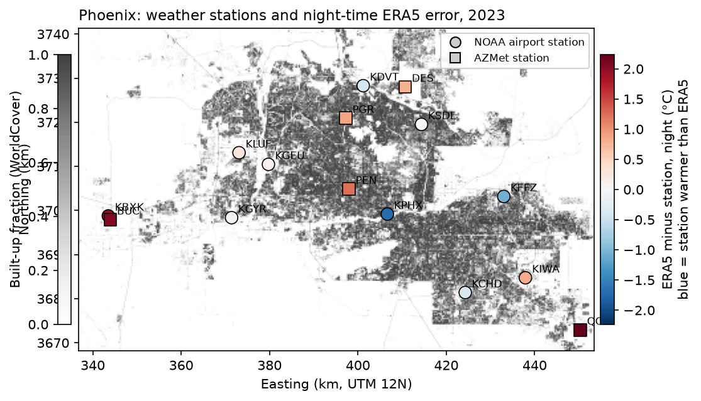
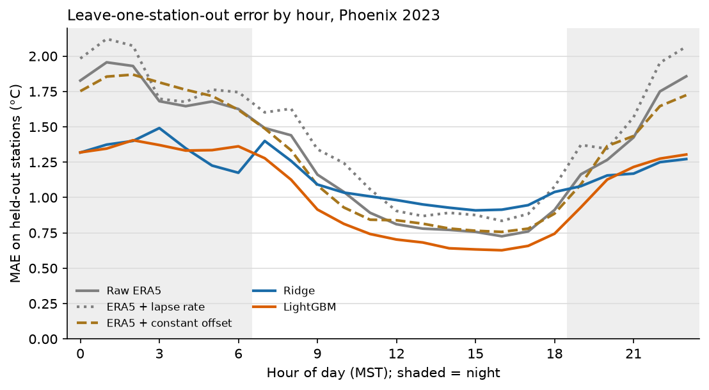
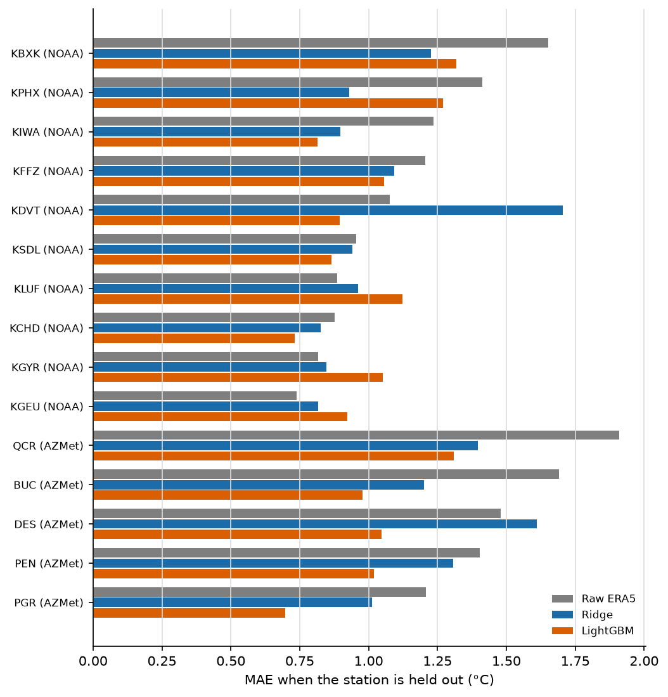

# street-air-temperature


Estimating street-level 2 m **air** temperature in Phoenix from coarse ERA5 reanalysis (~25 km), land cover, vegetation and elevation, validated on weather stations the model never saw.

**Status:** milestone 2 done: LightGBM cuts ERA5's error at unseen stations by 19%. Temperature catalog and API come next. Model, temperature catalog and API come next (see [Roadmap](#roadmap)).

Companion to [Urban-Heat-Downscaling](https://github.com/SaraEwaida/Urban-Heat-Downscaling), which downscales satellite **land surface** temperature. Surface temperature is the skin of roofs, roads and sand; air temperature at 2 m is what people feel. This project targets the second.

## Why

Reanalysis such as ERA5 gives hourly air temperature everywhere, but one value per ~25 km cell: it cannot separate a downtown street from an irrigated park or open desert a few kilometres away. Weather stations measure the real local value, but only at a few points. The goal is to learn the local correction from what surrounds each station, so it can be applied anywhere in the city.

## Data

All sources are free and need no account.

| Data | Source | Resolution | Use |
|---|---|---|---|
| Station air temperature | NOAA Integrated Surface Database (global-hourly CSV), via NOAA Open Data Dissemination on AWS | point, hourly | target (airports) |
| Station air temperature | Arizona Meteorological Network (AZMet) API, University of Arizona | point, hourly | target (turf, farmland, suburbs) |
| ERA5 2 m air temperature | Open-Meteo historical archive, `models=era5` | 0.25° (~25 km), hourly | coarse input |
| Land cover | ESA WorldCover v200, Planetary Computer | 10 m | site features |
| Elevation | Copernicus DEM GLO-30, Planetary Computer | 30 m | site features, lapse-rate baseline |
| Vegetation | Landsat 8/9 Collection 2 Level-2 NDVI, Planetary Computer | 30 m | site features |

Details that matter:

- **Station files** come from the `noaa-global-hourly-pds` S3 bucket: NCEI ended direct HTTPS download of ISD CSV in 2026, and ISD is superseded by GHCNh with no updates after August 2025. The 2023 study year is fully covered; GHCNh is the source to switch to for recent years.
- **ERA5 is requested as the raw grid-cell value** (`elevation=nan`). By default Open-Meteo adjusts temperature to the point's elevation; that correction is computed separately here as an explicit baseline (standard lapse rate, -6.5 °C/km), so the model's gain over it is visible.
- **Two station networks.** All NOAA stations around Phoenix are airports: open, paved and similar to each other, so on their own they cannot show what makes a park or farmland different. AZMet adds Phoenix Encanto and Phoenix Greenway (irrigated turf), Desert Ridge, Queen Creek and Buckeye (farmland and suburban edge). AZMet values are hourly averages stamped at the end of the hour, so they are assigned to the hour they end, matching ISD's routine reports a few minutes before the hour and ERA5 on the hour.
- **Station quality control:** ISD quality codes 2, 3, 6 and 7 are dropped; routine hourly METAR reports (FM-15) are preferred when several reports fall in one hour; values outside -15 to 55 °C are removed; single-hour spikes of more than 8 °C against both neighbouring hours are removed; stations with less than 55% of hours left are dropped. The threshold is 55%, not higher, because Chandler, Glendale and Goodyear airports report only about 60% of hours; errors will be reported by hour of day, so partial coverage does not bias the comparison. A per-station report is written to `outputs/qc_report.csv`.
- **Site features** are computed in circles of 100 m and 500 m around each station on a local UTM 12N grid: land-cover fractions (built-up, tree, shrub, grass/crop, bare, water), mean elevation, and median summer NDVI over up to five clear Landsat scenes. Station coordinates are deliberately not features, so the model has to learn from surroundings, not memorise places.
- Phoenix stays on MST (UTC-7) all year, so local hour is unambiguous.

## Setup

```bash
git clone https://github.com/SaraEwaida/street-air-temperature.git
cd street-air-temperature
python -m venv .venv && source .venv/bin/activate      # Windows: .venv\Scripts\Activate.ps1
pip install -e ".[dev]"
pytest
```

## Reproduce milestone 1

```bash
sat stations configs/phoenix.yaml   # NOAA stations, download, QC -> data/phoenix/observations.parquet
sat era5 configs/phoenix.yaml       # ERA5 at each station        -> data/phoenix/era5.parquet
sat features configs/phoenix.yaml   # site features                -> data/phoenix/site_features.csv
sat build configs/phoenix.yaml      # station-hour table           -> data/phoenix/dataset.parquet
sat map configs/phoenix.yaml        # station map                  -> outputs/figures/phoenix_stations.png
```

Or all steps at once: `sat all configs/phoenix.yaml`.

## Results

### Milestone 1: ERA5 against 15 stations, 2023

All 15 stations passed quality control (10 NOAA airports, 5 AZMet sites), giving 120,617 station-hours. Bias is ERA5 minus station in °C, so **negative = station warmer than ERA5**. Night is 19:00-06:00 local time.



| Station | Network | Bias, all hours | Night | Day | Built-up within 500 m | NDVI within 500 m |
|---|---|---:|---:|---:|---:|---:|
| Phoenix Sky Harbor (KPHX) | NOAA | -1.22 | **-1.72** | -0.73 | 0.61 | 0.05 |
| Falcon Field (KFFZ) | NOAA | -0.63 | -1.07 | -0.19 | 0.62 | 0.18 |
| Deer Valley (KDVT) | NOAA | -0.39 | -0.41 | -0.36 | 0.39 | 0.13 |
| Chandler (KCHD) | NOAA | +0.24 | -0.38 | +0.44 | 0.53 | 0.11 |
| Goodyear (KGYR) | NOAA | -0.01 | -0.08 | +0.01 | 0.41 | 0.14 |
| Scottsdale (KSDL) | NOAA | +0.24 | -0.05 | +0.53 | 0.73 | 0.14 |
| Glendale (KGEU) | NOAA | +0.23 | +0.12 | +0.26 | 0.50 | 0.10 |
| Luke AFB (KLUF) | NOAA | +0.24 | +0.28 | +0.20 | 0.17 | 0.13 |
| Williams Gateway (KIWA) | NOAA | +0.95 | +0.84 | +1.06 | 0.43 | 0.09 |
| Buckeye airport (KBXK) | NOAA | +1.24 | +1.99 | +0.50 | 0.21 | 0.13 |
| Desert Ridge (DES) | AZMet | +0.56 | +0.80 | +0.33 | 0.40 | 0.37 |
| Phoenix Greenway (PGR) | AZMet | +0.92 | +0.89 | +0.95 | 0.58 | 0.26 |
| Phoenix Encanto (PEN) | AZMet | +1.03 | +1.23 | +0.84 | 0.41 | 0.42 |
| Buckeye (BUC) | AZMet | +1.36 | +2.05 | +0.67 | 0.08 | 0.55 |
| Queen Creek (QCR) | AZMet | +1.63 | **+2.23** | +1.03 | 0.04 | 0.56 |

Overall: bias +0.45 °C, MAE 1.27 °C.

- **ERA5's night-time error follows the surroundings.** Across the 15 stations it correlates at -0.74 with built-up fraction and +0.71 with NDVI: ERA5 is too cool over dense, paved sites (the urban heat island, strongest at Sky Harbor) and too warm over irrigated parks and farmland (evaporative cooling, strongest at Queen Creek and Buckeye).
- **The effect is largest at night**, when the urban heat island is strongest, which is why errors will be reported by hour of day.
- **Without AZMet this was invisible:** airports alone span too narrow a range of surroundings. With 15 stations these correlations are a strong hint, not a result; testing on held-out stations in milestone 2 decides how much of it a model can use.
- Desert Ridge lost 42 hours to the range check, probably a sensor fault; every other station lost fewer than 3 hours to quality control.

## Reproduce milestone 2

ERA5 now also includes wind, cloud cover, sunshine and humidity, so re-run the ERA5 and build steps once:

```bash
sat era5 configs/phoenix.yaml
sat build configs/phoenix.yaml
sat model configs/phoenix.yaml      # leave-one-station-out evaluation + final model
```

### Model setup

- **Target:** station temperature minus raw ERA5. Every method predicts the station temperature, so all are scored on the same scale.
- **Validation: leave one station out.** Each of the 15 stations is held out in turn; models, imputers and scalers are fitted on the other 14 only. This answers the real question: how well does the correction work at a place with no station?
- **Methods:**
  - raw ERA5;
  - ERA5 moved to the station's elevation with a standard lapse rate;
  - ERA5 plus the training stations' mean offset;
  - Ridge regression on the features, with site x night interactions;
  - LightGBM on the same features.
- **Features:** land-cover fractions and NDVI within 100 m and 500 m, height relative to the ERA5 cell, hour of day and day of year (as sine and cosine), and ERA5 weather at that hour (temperature, 3-hour change, daily mean, wind, cloud cover, solar radiation, humidity). No station coordinates or names, so a held-out station is predicted only from its surroundings and the weather.
- **Setting:** reconstruction of past hours. The ERA5 daily mean uses the whole day, which is fine for historical maps but not for real-time use.
- **Outputs:** `outputs/model_summary.csv` (overall, night and day, and per network), `model_by_station.csv`, `model_by_hour.csv`, `model_importance.csv`, and figures `error_by_hour.png`, `error_by_station.png`.

### Milestone 2 results

Every number is from stations the model never saw (leave one station out, 15 folds, 120,617 station-hours). Errors are prediction minus station, °C.

| Method | MAE | RMSE | Bias | Night MAE | Day MAE | Mean absolute station offset |
|---|---:|---:|---:|---:|---:|---:|
| Raw ERA5 | 1.27 | 1.75 | +0.45 | 1.63 | 0.96 | 0.73 |
| ERA5 + lapse rate | 1.41 | 1.90 | +0.84 | 1.76 | 1.10 | 0.96 |
| ERA5 + constant offset | 1.26 | 1.72 | 0.00 | 1.62 | 0.94 | 0.68 |
| Ridge | 1.14 | 1.51 | -0.01 | **1.26** | 1.04 | **0.26** |
| **LightGBM** | **1.03** | **1.39** | -0.01 | 1.30 | **0.80** | 0.52 |

"Mean absolute station offset" is the average, over held-out stations, of the size of each station's mean error: how well a method gets a place's typical warmth or coolness right.

| Network | Raw ERA5 MAE | Ridge MAE | LightGBM MAE |
|---|---:|---:|---:|
| NOAA airports (76,899 h) | 1.12 | 1.05 | 1.03 |
| AZMet turf and farmland (43,718 h) | 1.54 | 1.31 | **1.03** |




- **LightGBM cuts the error at unseen stations by 19%** (1.27 to 1.03 °C) and removes the overall warm bias of ERA5.
- **The gain is largest where ERA5 is worst:** irrigated and agricultural AZMet sites go from 1.54 to 1.03 °C, for example Phoenix Greenway 1.21 to 0.72 and Queen Creek 1.91 to 1.26.
- **Ridge and LightGBM are good at different things.** Ridge is best at night and gets each station's typical offset far closer (0.26 vs 0.52 °C): with few stations, a smooth linear site effect generalises better than tree splits. LightGBM is clearly best by day, where the correction depends on weather and time. Combining the two is the obvious next step.
- **A standard lapse-rate correction makes ERA5 worse.** At night cold air collects in the low parts of the basin, so lower is not warmer; a fixed -6.5 °C/km adjustment fails here.
- **Most important LightGBM features:** built-up fraction within 100 m (20% of gain), ERA5 humidity (9%), hour of day (7%), height relative to the ERA5 cell (7%), built-up within 500 m (6%), solar radiation (6%).
- **Not uniform across stations.** LightGBM is worse than raw ERA5 at three west-side airports (Luke, Glendale, Goodyear) and Ridge at Deer Valley and Desert Ridge. With 15 stations, per-station results are noisy, and more stations (or more years) are the main way to firm them up.

## Reproduce milestone 3: temperature catalog

```bash
sat grid configs/phoenix.yaml       # site features for every 100 m pixel -> data/phoenix/grid_features.npz
sat catalog configs/phoenix.yaml    # maps for 8 hours, COGs + STAC     -> data/phoenix/catalog/
```

- **Grid features** are the station features computed for every 100 m pixel: WorldCover read at 10 m, class fractions and Landsat NDVI averaged over discs of 100 m and 500 m on a 50 m base grid, and DEM height. `sat grid` compares them with the stations' own 10 m-circle features at the 15 station pixels (`outputs/grid_feature_check.csv`), so the approximation is measured, not assumed.
- **Weather** for each pixel comes from its ERA5 0.25° cell: the same raw grid-cell values the stations were compared with, plus the same 3-hour change and daily mean.
- **Maps:** the final LightGBM from milestone 2 (trained on all 15 stations) predicts the correction for every land pixel; water pixels (more than 50% water within 100 m) are nodata.
- **Hours mapped:** the 15th of January, April, July and October 2023, at 05:00 (near the daily minimum, strongest urban heat island) and 15:00 (near the maximum), MST.
- **Catalog:** a self-contained STAC Collection with one Item per hour, using the projection and raster extensions. Each Item has three Cloud-Optimised GeoTIFF assets: `temperature`, `era5` (raw, same grid) and `correction`. The folder can be moved or uploaded as is: all links are relative.
- **Where the maps can be trusted.** The collection assets `area_of_applicability` and `dissimilarity_index` follow Meyer & Pebesma (2021), *Predicting into unknown space? Estimating the area of applicability of spatial prediction models*, Methods in Ecology and Evolution 12(9). Each pixel's site features are standardised, weighted by LightGBM importance, and compared with the nearest training station; the threshold is set by how unusual the stations were relative to each other, mirroring leave-one-station-out validation. A first, per-feature range check flagged 80% of land as extrapolation even in ordinary neighbourhoods, because a box over 15 features is far stricter than what the model's accuracy depends on; it is kept as a diagnostic (`outputs/catalog_support.csv`).
- Summary per hour: `outputs/catalog_summary.csv`; figure: `outputs/figures/air_temperature_july.png`.

### Milestone 3 results

To be filled after `sat catalog`.

## Roadmap

1. Station data pipeline: stations, QC, ERA5, site features, joined table.
2. Model: Ridge and LightGBM corrections to ERA5, validated by leaving whole stations out, against raw, lapse-rate and constant-offset ERA5; errors by hour of day, station and network.
3. Temperature catalog: 100 m air-temperature maps as Cloud-Optimised GeoTIFFs, indexed in a STAC catalog (this milestone).
4. Service: FastAPI endpoint (location and time in, temperature out) in Docker.
5. Results and limitations write-up.

## Layout

```
configs/phoenix.yaml   bbox, period, QC thresholds, feature radii, paths
src/streetair/
  isd.py               NOAA ISD station list, parsing, quality control (shared by both networks)
  azmet.py             AZMet station table and hourly API
  era5.py              Open-Meteo ERA5 request and parsing
  features.py          site features from Planetary Computer (windowed reads)
  dataset.py           station-hour table, ERA5 context, lapse-rate baseline, station summary
  model.py             leave-one-station-out evaluation, Ridge and LightGBM, final model
  grid.py              site features for every 100 m pixel (disc averages)
  catalog.py           per-pixel prediction, COG writing, STAC collection
  plots.py             station map, error by hour, error by station, map figure
  cli.py               `sat` command
tests/                 fixtures in the real formats; no network needed
```
